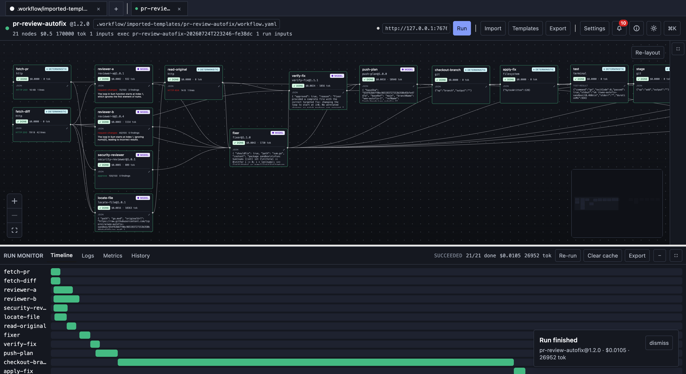
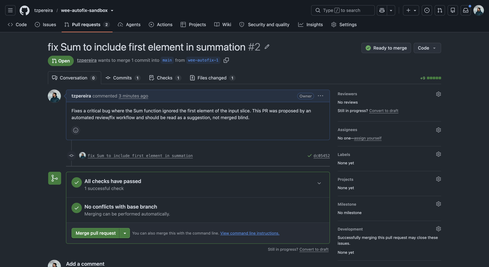

# Workflow Execution Engine

[](https://github.com/thettteus/workflow-execution-engine/actions/workflows/go.yml) [](https://github.com/thettteus/workflow-execution-engine/actions/workflows/ui.yml) [](https://github.com/thettteus/workflow-execution-engine/actions/workflows/vocabulary.yml) [](LICENSE)

`wee` turns engineering processes into executable, auditable, versioned workflows.

A lot of engineering knowledge still lives in documents, Slack threads, scripts, and people's heads. `wee` turns that knowledge into workflows with source code, versioning, execution history, replay, artifacts, observability, and metrics.

**Workflows are software.** LLMs can execute parts of a workflow, but they do not control the system. `wee`
is not an AI agent framework, chat product, or prompt builder.

## Proof, not a mockup

The flagship graph below is 21 real nodes (7 model, 14 deterministic) — three parallel reviewers, a Fixer
whose own output is judged by a separate verifier, and a real write/test/stage/commit tail — running end to
end against a live repository:



That run's accepted fix became a real GitHub pull request, opened by the workflow itself through GitHub's
Git Data API — not a mocked write:



The full flagship proof — three real public-repo targets, two safe rejections, one successful fix, exact
token/cost figures — is in [docs/CASE-STUDY.md](docs/CASE-STUDY.md).

## Quickstart

Build the CLI and run the first workflow. It needs no API key:

```sh
go build -o wee ./cli
./wee cli
```

That executes a real, recorded, tool-only run in a temporary workspace and prints its artifact.

From there, [docs/TUTORIAL.md](docs/TUTORIAL.md) is a copy-pasteable terminal walkthrough covering:

```text
run
cli
inspect
replay
cache
backup
export
serve
```

## Why

**Engineer the context. Delegate to the model only what actually fits in it.**

LLM inference got cheaper. The amount of inference software performs did not.

Agentic systems can retry, loop, expand context, call tools, and keep going unless something outside the model decides when enough is enough. `wee` puts those decisions in the runtime.

- **The engine owns the loops.** Retries, branching, and merging are explicit control flow. The model does not decide whether it should "try again."
- **Context is declared per step.** Give a step the diff instead of the repo when the diff is all it needs.
- **Outputs have contracts.** Schemas are enforced. Validation failures can trigger retries with the error itself, without rebuilding an ever-growing transcript.
- **Equivalent work can be reused.** Content-addressed caching avoids paying for the same work again across runs.
- **Budgets stop execution before the next call.** Cost limits are part of runtime behavior rather than something discovered on the invoice.
- **Savings have receipts.** The event log records when caching, policy, or control flow avoided work and attributes the saved cost to its cause.

The runtime, not the model, decides how work executes.

## Who it's for

- **Developers** — run PR review, test generation, or a refactor plan like git/terraform, for a few cents, with receipts.
- **Scrum Masters / delivery leads** — encode recurring ceremonies and gates as versioned workflows, not checklists.
- **Product Owners / Managers** — research → PRD → review workflows that produce auditable, contracted artifacts.
- **CTOs / engineering leaders** — reproducible process, bounded and attributed spend, a tamper-evident record, nothing leaving your environment.

Everyone is programming their organization's processes, not prompting a model. See [docs/VISION.md](docs/VISION.md).

## Running it for real

### Self-hosted service

Run the single-process service with the built UI:

```sh
pnpm --dir ui install
pnpm --dir ui build
go build -o wee ./cli
./wee serve --addr 127.0.0.1:7676 --workspace .workflow --dir . --templates examples/templates --ui-dir ui/dist
```

Or run the Docker Compose path:

```sh
docker compose up --build
```

Open `http://localhost:7676`. History, artifacts, cache, settings, and imported workflows are kept in
Compose volumes across stop/restart. See [docs/self-hosted.md](docs/self-hosted.md) for backup/restore and
upgrade notes.

### Running the CLI and UI together

`make dev` starts the CLI backend and UI together.

```sh
make dev
```

It builds the CLI, installs the UI dependencies, starts `wee serve` on `127.0.0.1:7676`, and runs Vite on `localhost:5173`.

By default, `DIR` points to the repository root.

For workflows that reference files inside another directory:

```sh
make dev DIR=examples/pr-review
```

For an LLM-backed workflow, add a provider key to `.env` at the repository root:

```sh
OPENAI_API_KEY=...
```

or:

```sh
ANTHROPIC_API_KEY=...
```

`wee` does not load `.env` itself. `make dev` sources it before starting the processes.

Open:

```text
http://localhost:5173
```

The canvas starts empty. Click **Import** and select a workflow file, for example:

```text
examples/pr-review/workflow.yaml
```

The workflow should match the `DIR` used to start `make dev` so relative file references resolve correctly.

One Ctrl-C stops both processes. If something remains running:

```sh
make stop
```

Other development commands:

```sh
make build   # CLI only
make serve   # backend only
make ui      # frontend only
```

See the `Makefile` for the full command list and configurable variables including `ADDR`, `UI_PORT`, `WORKSPACE`, and `DIR`.

## Status

Phase 1 (MVP) is complete through the engine, CLI, SDK, and interface (M1.0–M1.15); the old M1.16/M1.17
release gates are superseded by the Phase 2 local-first product-hardening plan.

Phase 2 is in progress. The durable local control plane, safe mutation checkpoints, self-hosted packaging,
connections, the visual/notifications shell, and a real flagship PR-review-and-fix run against a public
repository are complete (M2.0–M2.6, M2.9–M2.13). The next sequential milestone is M2.7 (team self-hosting).
See [docs/ROADMAP.md](docs/ROADMAP.md) and [docs/EXECUTION-PHASE2.md](docs/EXECUTION-PHASE2.md) — its
`## Status` section is the authoritative, current picture.

There is no v1-stable API yet.

Hosted/managed operation is intentionally later; the primary product should work when a user downloads `wee`
and runs it in their own environment.

## Documentation

Start here, in order:

- [docs/quickstart.md](docs/quickstart.md) — the shortest path to a first run
- [docs/TUTORIAL.md](docs/TUTORIAL.md) — a copy-pasteable terminal walkthrough
- [docs/CASE-STUDY.md](docs/CASE-STUDY.md) — the flagship run against a public repo, in narrative form
- [docs/writing-contracts.md](docs/writing-contracts.md) — authoring your own Workers and Contracts
- [docs/self-hosted.md](docs/self-hosted.md) — running it as a service, with backup/restore and upgrades

Reference:

- [docs/cli-reference.md](docs/cli-reference.md) — every `wee` command and flag
- [docs/sdk-reference.md](docs/sdk-reference.md) — the Go authoring SDK
- [docs/glossary.md](docs/glossary.md) — shared terminology

Design and rationale:

- [docs/VISION.md](docs/VISION.md) — why the project exists, and what it deliberately is not
- [docs/ARCHITECTURE.md](docs/ARCHITECTURE.md) — component map and execution lifecycle
- [docs/spec/](docs/spec/) — testable requirements, one file per capability, with `REQ-*`/`NFR-*` IDs
- [docs/adr/](docs/adr/) — architectural decisions and the reasoning behind them
- [docs/threat-model.md](docs/threat-model.md) — trust boundaries and mitigations

Working on the code — human or coding agent — starts at [AGENTS.md](AGENTS.md), the index that names the
reading order, the binding rules in [docs/CONSTITUTION.md](docs/CONSTITUTION.md), and the current milestone
in [docs/EXECUTION-PHASE2.md](docs/EXECUTION-PHASE2.md). Contributions: [CONTRIBUTING.md](CONTRIBUTING.md).
Security reports: [SECURITY.md](SECURITY.md).

## License

Apache-2.0. See [LICENSE](LICENSE).
